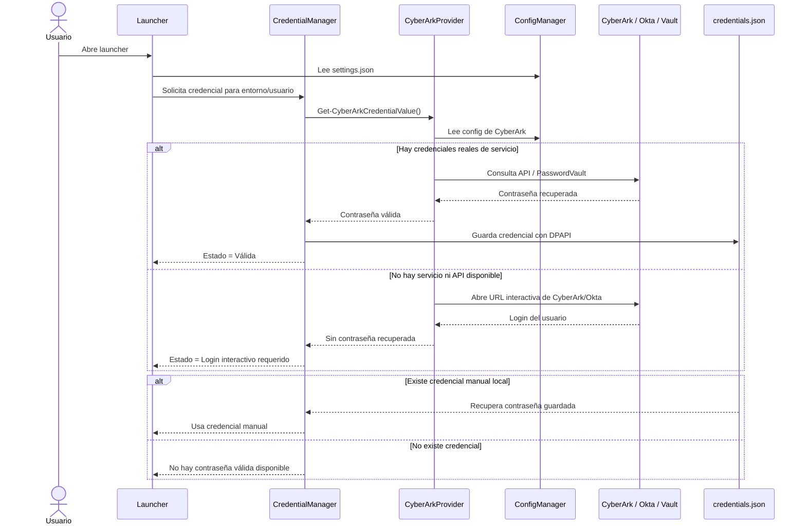
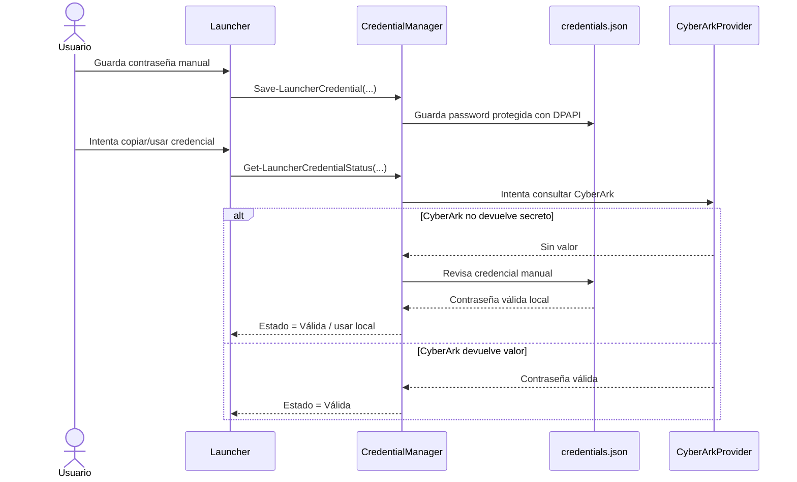

# Documentación de CyberArk para APPLauncher

## 1. Resumen ejecutivo

APPLauncher integra una capa de gestión de credenciales para facilitar el acceso a entornos y herramientas administrativas. En el estado actual del proyecto, la integración con CyberArk está implementada como una estrategia híbrida:

- se intenta usar CyberArk como primera fuente de verdad cuando hay credenciales reales del sistema,
- si no hay autenticación programática ni credenciales de servicio válidas, la aplicación abre la sesión interactiva de CyberArk/Okta para que el usuario complete el login con MFA,
- si la contraseña no puede recuperarse de CyberArk, el flujo conserva el respaldo manual y no marca la credencial como recuperada.

Esto es una decisión de seguridad y estabilidad: el sistema evita falsos positivos, no intenta guardar el HTML de la página de login como contraseña, y no bloquea el uso de una credencial manual ya guardada.

---

## 2. Contexto técnico actual

La configuración actual del proyecto en [Config/settings.json](Config/settings.json) incluye:

- `cyberArk.enabled = true`
- `cyberArk.interactiveLogin = true`
- `cyberArk.loginUrl = https://aon.cyberark.cloud/privilegecloud/Accounts`
- `username = null`
- `password = null`
- `appId = null`
- `allowManualFallback = true`
- `safeByEnvironment` con valores por entorno: DEV, QC y PROD

Esto indica que la app está configurada para intentar una integración, pero sin la infraestructura real del tenant para recuperar secretos automáticamente.

La lógica que implementa este comportamiento vive principalmente en [Modules/CyberArkProvider.ps1](Modules/CyberArkProvider.ps1) y [Modules/CredentialManager.ps1](Modules/CredentialManager.ps1).

---

## 3. Flujo actual implementado

### 3.1 Flujo funcional real

1. El launcher carga la configuración desde `settings.json`.
2. El gestor de credenciales revisa si existe una contraseña manual guardada para el usuario y entorno.
3. Si no existe, intenta consultar CyberArk.
4. Si CyberArk tiene credenciales de servicio válidas, intenta recuperar la contraseña desde la API o vault.
5. Si no hay credenciales de servicio y la integración está configurada para login interactivo, se abre la URL de CyberArk/Okta.
6. El sistema no acepta como válida una contraseña que no fue realmente devuelta; si la sesión interactiva solo abre navegador y falla la recuperación, mantiene un estado explícito y no marca el secreto como recuperado.
7. Si existe una credencial manual válida, se usa como respaldo y no se bloquea por la falta de CyberArk.

### 3.2 Regla de negocio importante

La política del sistema es la siguiente:

- CyberArk es primera fuente si hay acceso programático real.
- Login interactivo es un fallback seguro para autenticación del usuario, no para extracción automática.
- Credencial manual guardada sigue funcionando si ya existe.
- No se guarda como contraseña el HTML de la página de login.
- No se reporta éxito si no se recuperó una contraseña real.

---

## 4. Arquitectura de integración

### 4.1 Componentes

- `Launcher.ps1`  
  Punto de entrada de la aplicación y orquestación de la UI.

- `Modules/ConfigManager.ps1`  
  Carga y normaliza la configuración JSON, evita errores por propiedades faltantes.

- `Modules/CyberArkProvider.ps1`  
  Encapsula la lógica de detección, autenticación interactiva y consulta a CyberArk.

- `Modules/CredentialManager.ps1`  
  Gestiona credenciales locales, expiración, fallback manual, validación de estado y seguridad del secreto.

- `Config/settings.json`  
  Configuración central de CyberArk, entorno, usuario y safe por entorno.

- `Config/credentials.json`  
  Credenciales locales persistidas por usuario y entorno, protegidas con DPAPI.

- `Modules/CredentialForm.ps1`  
  UI para mostrar, guardar, copiar y gestionar credenciales manuales.

### 4.2 Diagrama de arquitectura

```mermaid
flowchart LR
    U[Usuario] --> UI[Launcher.ps1]
    UI --> CM[CredentialManager.ps1]
    UI --> CA[CyberArkProvider.ps1]
    UI --> CFG[ConfigManager.ps1]

    CFG --> SETTINGS[settings.json]
    CM --> CRED[credentials.json]
    CM --> DPAPI[DPAPI / Windows SecureString]

    CA --> CYB[CyberArk / Okta]
    CA --> LOGIN[Login interactivo]
    CA --> API[API / Password Vault (si existe)]

    CM --> LOCAL[Credencial manual guardada]
    CA --> VAULT[Vault / Safe / Secret]

    LOCAL --> USE[Uso para iniciar sesión o copiar contraseña]
    VAULT --> USE
    LOGIN --> USE
```

---

## 5. Flujo de secuencia

### 5.1 Flujo actual con CyberArk no disponible



### 5.2 Flujo de credencial manual guardada



---

## 6. Matriz de viabilidad de CyberArk para este proyecto

### 6.1 Diagnóstico actual

| Área | Estado | Observación |
|---|---|---|
| Credencial de servicio CyberArk | No disponible | `username`, `password` y `appId` están nulos |
| API del tenant | No confirmada | No hay evidencia de acceso programático real |
| Login interactivo | Sí | Se abre la URL de Okta/CyberArk |
| Fallback manual | Sí | La app conserva la credencial manual si existe |
| Recuperación automática real | No viable con el estado actual | Falta acceso real al Safe y a la API |
| Seguridad de la app | Sí | No se reporta éxito si no se recupera una contraseña real |

### 6.2 Conclusión

La viabilidad real de la integración depende de la existencia de un acceso seguro y automatizable al tenant de CyberArk. Con el nivel actual de configuración, el proyecto no puede recuperar contraseña automáticamente. El comportamiento actual es correcto y seguro: abrir la sesión interactiva y no inventar una contraseña.

---

## 7. Lista de comprobación para validar la viabilidad de CyberArk

### 7.1 Autenticación y permisos
- ¿Existe un usuario o aplicación de servicio de CyberArk para esta solución?
- ¿El servicio tiene permisos de lectura sobre los safes requeridos?
- ¿Se puede autenticar desde un proceso automatizado, no solo desde un navegador?
- ¿Hay un `appId`, `client_id`, token o credencial de servicio válida?

### 7.2 API y endpoints
- ¿La Password Vault API está habilitada en este tenant?
- ¿La API responde con una cuenta válida para consulta de contraseñas?
- ¿Se puede consumir desde PowerShell o desde un servicio local?
- ¿Hay documentación oficial del endpoint que debe usarse?

### 7.3 Mapeo del Safe y la cuenta
- ¿Qué Safe corresponde a cada entorno: DEV, QC y PROD?
- ¿Qué nombre exacto de cuenta usa CyberArk para cada usuario?
- ¿El patrón de naming es fijo o debe consultarse por `search`?
- ¿La cuenta vive en un Safe distinto por proyecto o por entorno?

### 7.4 Estructura de respuesta
- ¿La API devuelve la contraseña en `Password`, `secret`, `Secret`, `value`, `content` u otro campo?
- ¿La respuesta incluye un objeto con propiedades adicionales?
- ¿Se requiere parsear JSON o un resultado tipo string?
- ¿La API responde con un `value` o con un `secretId` que luego debe resolverse?

### 7.5 MFA / SSO / Okta
- ¿La autenticación del tenant requiere Okta MFA en cada sesión?
- ¿El acceso a la API requiere el mismo flujo de Okta o hay un mecanismo de servicio?
- ¿Se puede usar OAuth/SSO para un servicio sin intervención humana?
- ¿Hay restricciones de IP, origen o identidad que bloquean llamadas automáticas?

### 7.6 Seguridad y operación
- ¿Se puede almacenar la credencial de servicio en forma segura?
- ¿Se puede rotar la contraseña del servicio sin romper la app?
- ¿Se tiene un proceso para renovar permisos o secret management?
- ¿Hay política de uso para no exponer secretos en logs o configuración?

---

## 8. Recomendación de implementación

La recomendación actual para este proyecto es la siguiente:

1. Mantener el flujo manual como respaldo operativo.
2. Mantener CyberArk en modo de autenticación interactiva cuando no hay API real disponible.
3. No forzar una extracción automática sin credenciales válidas del tenant.
4. Solicitar al tenant la información de Safe, permisos y endpoint para evaluar viabilidad real.
5. Solo cuando exista un acceso real a la API, codificar la integración programática en [Modules/CyberArkProvider.ps1](Modules/CyberArkProvider.ps1).

---

## 9. Observaciones finales

La integración actual debe seguir siendo segura y honesta con el usuario. En este punto del proyecto, el componente más importante no es intentar forzar la recuperación automática, sino validar correctamente si existe infraestructura de CyberArk suficiente para hacerlo.

La aplicación ya corrige los errores de cierre, respeta el flujo manual, protege la credencial local y evita falsos positivos. Eso es una base sólida para una integración real cuando el tenant esté habilitado para ello.
