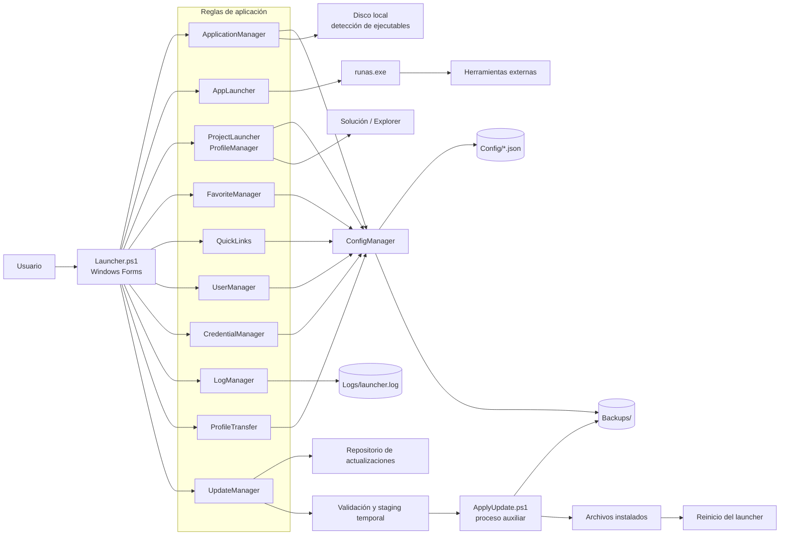
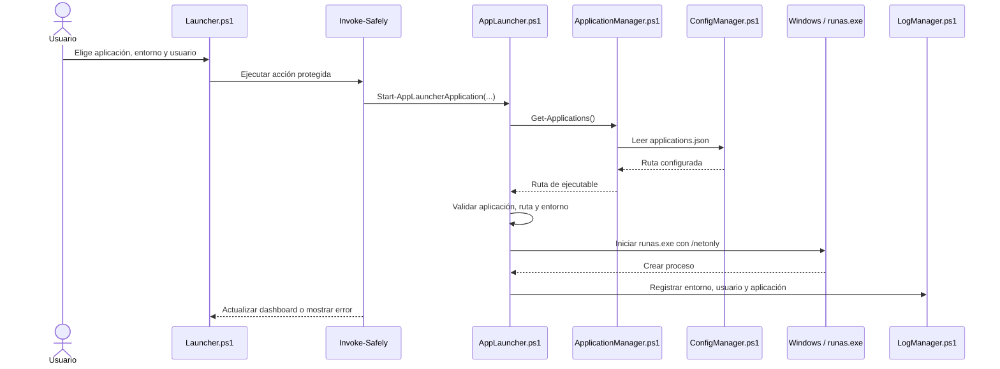
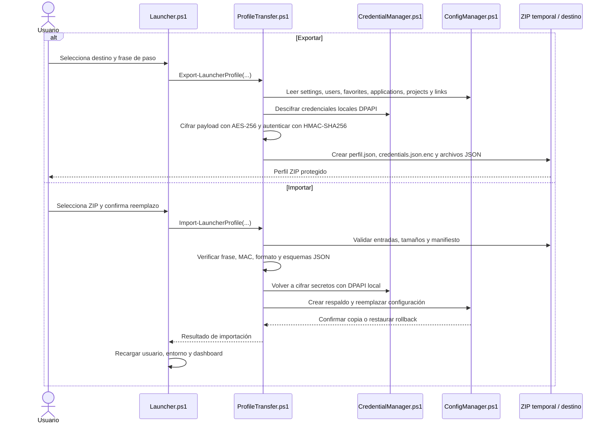
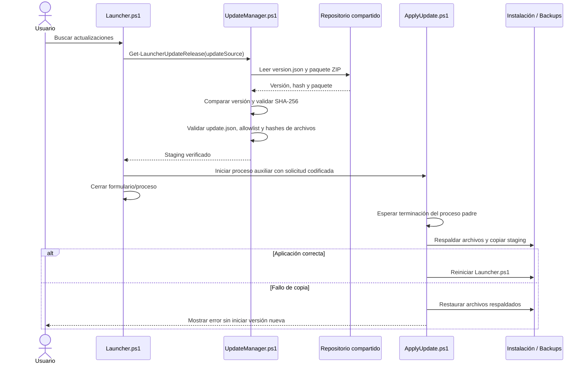

# APPLauncher

APPLauncher es una aplicación de escritorio para Windows construida con PowerShell y Windows Forms. Centraliza el inicio de herramientas administrativas, perfiles de proyecto, favoritos, accesos web, gestión de usuarios y credenciales, métricas de actividad y actualización del propio launcher.

## Licencia y atribución

APPLauncher se distribuye bajo [PolyForm Noncommercial License 1.0.0](LICENSE). Permite usar, modificar y compartir el software para fines no comerciales, conservando el texto de la licencia y el aviso de copyright. Reconocimiento: **APPLauncher, creado por Diego Quinonez**.

Esta licencia prohíbe el uso comercial, no solamente vender copias. Un uso dentro de una actividad empresarial puede quedar fuera del permiso aunque no se cobre por el programa. Para esos casos se requiere autorización separada del titular. Revisa el texto completo en `LICENSE`.

## Inicio rápido

- Ejecutar desde código: `./Launcher.ps1` (PowerShell en Windows).
- Compilar el ejecutable: `./Build.ps1` (requiere el módulo `ps2exe`; el icono se toma de `Assets/favicon.ico`).
- Ejecutar las pruebas: `./Tests/Run-Tests.ps1` (Pester 3.4 o posterior).

El archivo `Launcher.ps1` determina la raíz de instalación, carga los módulos activos mediante dot-sourcing, prepara la configuración y las aplicaciones detectadas, crea la ventana principal y conecta sus eventos. `APPLauncher.exe` es el artefacto compilado de ese script.

## Funcionalidades

- Inicio de SSMS, Visual Studio, VS Code y Report Builder. Las rutas se detectan en ubicaciones habituales y se guardan en `Config/applications.json`.
- Selección de usuario y entorno (`DEV`, `QC` o `PROD`). El inicio se realiza con `runas.exe` y el modificador `/netonly`; el launcher valida la ruta y el entorno antes de iniciar el proceso.
- Perfiles de proyecto con aplicaciones de arranque, solución `.sln` y/o carpeta de trabajo. Se validan todas las rutas antes de ejecutar acciones.
- Favoritos vinculados a usuario, entorno y aplicación.
- Accesos web persistidos, limitados a URLs absolutas `http` o `https` y sin credenciales embebidas.
- Administración de usuarios, credenciales, proyectos y accesos web.
- Dashboard con últimas y más usadas aplicaciones/proyectos, contadores de actividad, última detección y estado de credenciales.
- Registro de eventos de inicio, actividad de proyecto y errores en `Logs/launcher.log`.
- Exportación e importación de perfiles protegidos por frase de paso, con validación y respaldo previo.
- Búsqueda e instalación de actualizaciones desde un repositorio configurado.

## Arquitectura

`Launcher.ps1` concentra la composición de la interfaz y enlaza eventos con módulos de lógica. Los módulos activos comparten el ámbito de PowerShell al cargarse con dot-sourcing. La persistencia se separa entre configuración JSON, logs de texto, respaldos y archivos temporales.



### Lanzamiento de una aplicación

El inicio de aplicaciones no consulta ni descifra la bóveda de credenciales: delega la autenticación interactiva a `runas.exe`. La gestión de credenciales es una funcionalidad separada para guardar, consultar, copiar y exportar secretos.



### Exportación e importación de perfil

El ZIP incluye los seis archivos de configuración del perfil y un manifiesto. Las credenciales locales, protegidas por DPAPI para el usuario de Windows actual, se descifran durante la exportación y se vuelven a proteger para transporte con la frase de paso. En la importación se validan las entradas permitidas y los esquemas; las credenciales se vuelven a cifrar con DPAPI en la máquina/usuario destino. Antes de reemplazar configuración se crea un respaldo, y un fallo durante la copia restaura los archivos previos.



### Actualización

La actualización no reemplaza archivos desde el proceso principal. `UpdateManager.ps1` comprueba la versión publicada, verifica SHA-256 del paquete y de cada archivo, aplica una lista permitida de rutas y prepara el staging. Después inicia `ApplyUpdate.ps1` en un proceso separado; este espera el cierre del launcher, respalda los archivos afectados, instala la versión y puede restaurar el estado anterior si falla la aplicación.



## Módulos

Los módulos indicados como **activos** se cargan desde `Launcher.ps1`. `ApplyUpdate.ps1` es un helper de proceso independiente iniciado por el actualizador. Los scripts heredados/inactivos no forman parte del flujo actual del launcher.

| Archivo | Estado | Responsabilidad técnica |
|---|---|---|
| `Modules/AppLauncher.ps1` | Activo | Resuelve el dominio asociado al entorno, valida la ruta de aplicación y la inicia mediante `runas.exe /netonly`; registra el inicio. |
| `Modules/ApplicationManager.ps1` | Activo | Lee/escribe `applications.json`, detecta SSMS, Visual Studio, VS Code y Report Builder, y guarda la fecha del último escaneo. |
| `Modules/Applications.ps1` | Inactivo | Implementación anterior de detección de ejecutables; no se carga desde el punto de entrada actual. |
| `Modules/ApplyUpdate.ps1` | Helper independiente | Valida la solicitud y el manifiesto preparados, espera el cierre del proceso padre, respalda y reemplaza archivos permitidos, restaura en caso de error y reinicia. |
| `Modules/Common.ps1` | Inactivo/vacío | Archivo sin contenido; no participa en el runtime actual. |
| `Modules/ConfigManager.ps1` | Activo | Define rutas de `Config`, `Backups` y `Logs`; inicializa archivos base, lee/escribe JSON y crea respaldos. |
| `Modules/CredentialForm.ps1` | Activo | Ventana WinForms para guardar, comprobar, copiar y eliminar credenciales; limpia el portapapeles mediante temporizador. |
| `Modules/CredentialManager.ps1` | Activo | Persistencia de credenciales, cifrado DPAPI, lectura/descifrado, estado y vencimiento de ocho horas, y limpieza de credenciales expiradas. |
| `Modules/Credentials.ps1` | Inactivo/heredado | Funciones anteriores basadas en `cmdkey`; no es el gestor usado por el punto de entrada actual. |
| `Modules/FavoriteForm.ps1` | Activo | Ventana WinForms para crear, editar, seleccionar y eliminar favoritos. |
| `Modules/FavoriteManager.ps1` | Activo | CRUD de favoritos persistidos en `favorites.json` con usuario, entorno y aplicación. |
| `Modules/Favorites.ps1` | Inactivo/vacío | Archivo sin contenido; no participa en el runtime actual. |
| `Modules/Logging.ps1` | Inactivo/vacío | Archivo sin contenido; el registro actual está en `LogManager.ps1`. |
| `Modules/LogManager.ps1` | Activo | Escribe eventos de aplicación/proyecto/errores, calcula métricas del dashboard, expone lectura y permite limpiar el log. |
| `Modules/ProfileManager.ps1` | Activo | CRUD de perfiles de proyecto en `projects.json`. |
| `Modules/ProfileTransfer.ps1` | Activo | Exporta/importa ZIPs; protege credenciales portables con PBKDF2, AES-256-CBC y HMAC-SHA256; valida archivos, respalda y ejecuta rollback. |
| `Modules/ProjectLauncher.ps1` | Activo | Valida proyecto, aplicaciones, solución y carpeta antes de iniciar acciones; lanza aplicaciones, solución y Explorer y registra el proyecto. |
| `Modules/Projects.ps1` | Inactivo/vacío | Archivo sin contenido; la gestión actual está en `ProfileManager.ps1` y `ProjectsForm.ps1`. |
| `Modules/ProjectsForm.ps1` | Activo | UI para administrar perfiles, rutas de solución/carpeta y aplicaciones de inicio. |
| `Modules/QuickLinks.ps1` | Activo | Normaliza y valida URLs HTTP/HTTPS, impide nombres duplicados, persiste en `links.json` y abre el destino. |
| `Modules/QuickLinksForm.ps1` | Activo | UI CRUD para accesos web. |
| `Modules/ThemeManager.ps1` | Activo | Aplica colores visuales diferenciados para DEV, QC y PROD. |
| `Modules/UiHelpers.ps1` | Activo | Message boxes comunes y `Invoke-Safely`, que captura excepciones, las registra y las presenta al usuario. |
| `Modules/UpdateManager.ps1` | Activo | Consulta versiones, valida nombres/rutas y SHA-256 del ZIP/manifiesto, extrae staging temporal y entrega la actualización al helper. |
| `Modules/UserManager.ps1` | Activo | CRUD de usuarios en `users.json`; impide eliminar o modificar el usuario predeterminado y evita duplicados. |
| `Modules/Users.ps1` | Inactivo/heredado | Implementación anterior de operaciones de usuario; no se carga desde el punto de entrada actual. |
| `Modules/UsersForm.ps1` | Activo | UI para administrar usuarios y actualizar el selector principal. |

## Persistencia

| Archivo | Contenido lógico |
|---|---|
| `Config/settings.json` | Usuario y entorno seleccionados, tema y origen de actualizaciones. |
| `Config/users.json` | Usuario predeterminado y lista de usuarios. |
| `Config/applications.json` | Rutas de ejecutables detectadas/configuradas y fecha del último escaneo. |
| `Config/favorites.json` | Colección de favoritos con usuario, entorno y aplicación. |
| `Config/projects.json` | Perfiles con nombre, usuario, entorno, solución, carpeta y aplicaciones de inicio. |
| `Config/links.json` | Colección de accesos web con nombre y URL. |
| `Config/credentials.json` | Credenciales por usuario/entorno, contraseña protegida por DPAPI y marca `updatedAt`. |
| `Logs/launcher.log` | Eventos de aplicación, proyecto y error en texto delimitado por ` | `. |
| `Backups/` | Respaldos de configuración e instalación generados por importación/actualización. |

La bóveda local DPAPI depende del usuario de Windows que la generó; no es portable directamente a otra cuenta. La exportación convierte las credenciales a un payload protegido por frase de paso y, al importar, vuelve a cifrarlas para el contexto DPAPI local.

## Estructura principal

```text
Launcher.ps1                 Punto de entrada y composición de la UI
Build.ps1                    Compilación con ps2exe
APPLauncher.exe              Ejecutable compilado
Launcher.version             Versión del producto
Modules/                      Lógica, persistencia, formularios y actualización
Config/                       JSON de configuración local
Backups/                      Respaldos
Logs/launcher.log             Registro de actividad
Assets/favicon.ico            Icono del ejecutable
Tests/                        Suite Pester por funcionalidad/sprint
Publish-Update.ps1             Generación de paquetes de actualización
```

## Desarrollo y validación

```powershell
.\Tests\Run-Tests.ps1
.\Build.ps1
```

Las pruebas usan directorios temporales para configuración, logs, respaldos y paquetes. Las llamadas a `runas.exe` y a aplicaciones externas se simulan; la suite no valida autenticación contra dominios ni instala una actualización en el directorio real. Consulta [Tests/README.md](Tests/README.md) para el alcance y las limitaciones de las pruebas.
