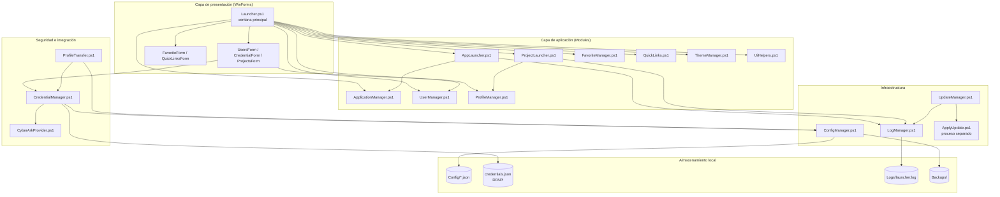
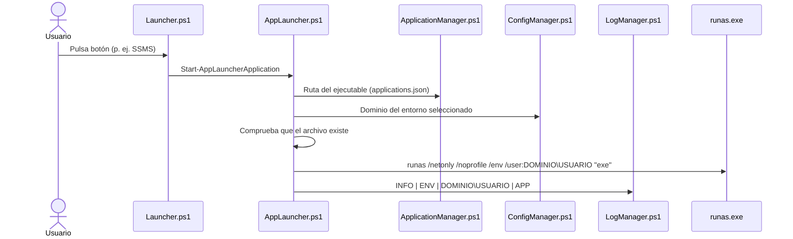
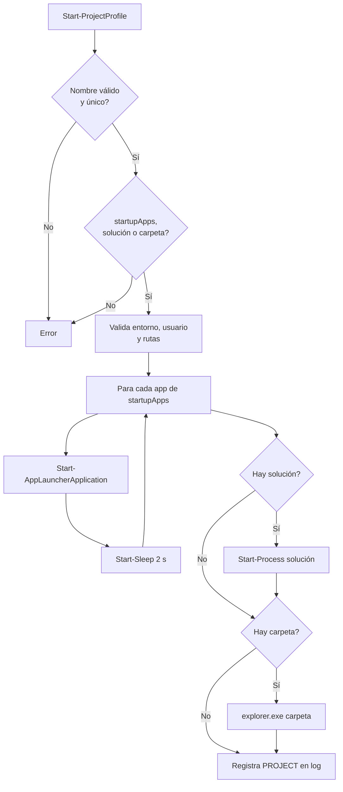
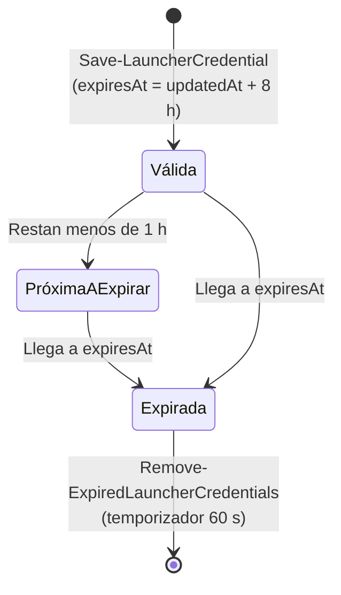
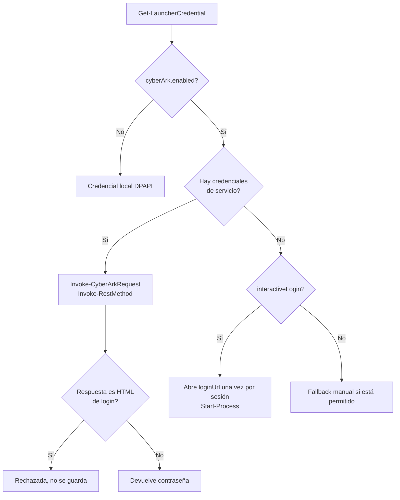
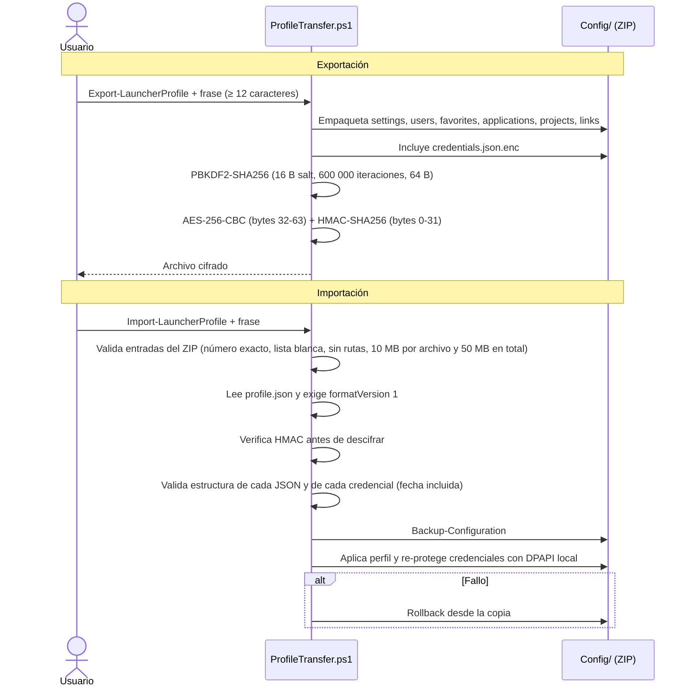
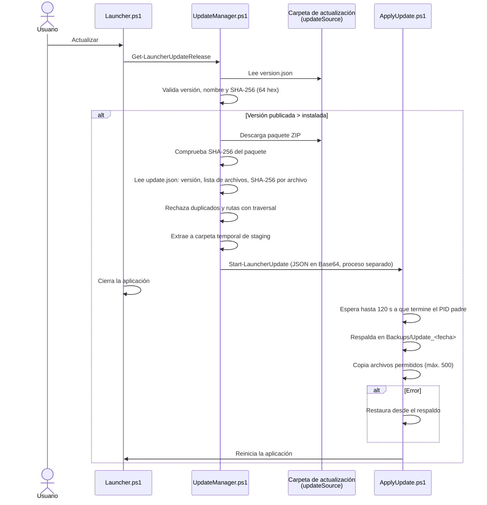

# APPLauncher: Documento técnico

**Versión documentada:** 4.4.0 (`Launcher.version`)
**Tecnología:** PowerShell 5.x/7 + Windows Forms (WinForms), distribuible como `APPLauncher.exe` (ps2exe)
**Plataforma:** Windows
**Licencia:** PolyForm Noncommercial 1.0.0 (`LICENSE`)

---

## 1. Resumen

APPLauncher es una aplicación de escritorio para Windows que centraliza el arranque de herramientas de desarrollo y administración (SSMS, Visual Studio, VS Code, Report Builder) bajo la identidad de un usuario de dominio y un entorno (ALPHA, BETA, etc.). Además:

- Gestiona usuarios, entornos, dominios y credenciales temporales (expiran a las 8 horas).
- Permite definir **proyectos** (perfiles de arranque que abren aplicaciones, una solución y una carpeta).
- Mantiene **favoritos** y **accesos rápidos** (URLs).
- Muestra un **dashboard** de métricas a partir del log de ejecuciones.
- Exporta e importa **perfiles** cifrados (contraseña, PBKDF2 + AES-256 + HMAC).
- Aplica **actualizaciones** desde una carpeta compartida verificada por SHA-256.
- Tiene una integración **en fase de viabilidad** con CyberArk (modo manual/interactivo).

---

## 2. Alcance y objetivos

| Objetivo                                        | Cómo se cumple                                                                                        |
| ----------------------------------------------- | ------------------------------------------------------------------------------------------------------ |
| Arrancar herramientas con la identidad correcta | `runas.exe /netonly` (`Modules/AppLauncher.ps1`)                                                   |
| Evitar contraseñas en texto plano              | Credenciales protegidas con DPAPI (`Modules/CredentialManager.ps1`)                                  |
| Limitar la vida de las credenciales             | Expiran 8 horas después de `updatedAt`                                                              |
| Portar configuración entre equipos             | Exportación cifrada (`Modules/ProfileTransfer.ps1`)                                                 |
| Actualizar sin intervención manual de archivos | Paquete ZIP verificado + proceso auxiliar (`Modules/UpdateManager.ps1`, `Modules/ApplyUpdate.ps1`) |
| Calidad y seguridad del repositorio             | Pester 3.4.0, PSScriptAnalyzer, Gitleaks y hook pre-commit (`.github/workflows`, `.githooks`)      |

**Fuera de alcance:** gestión de contraseñas corporativas, administración de CyberArk (solo se abre la URL de login), ejecución en Linux/macOS.

---

## 3. Estructura del repositorio

```
APPLauncher/
├── Launcher.ps1              Punto de entrada y construcción de la interfaz principal
├── Launcher.version          Versión instalada (4.4.0)
├── Launcher.bat              Lanzador batch
├── LanzadorHerramientasAdm.bat
├── Build.ps1                 Compilación a APPLauncher.exe con ps2exe
├── Modules/                  Lógica de negocio y formularios WinForms
├── Config/                   Configuración JSON (settings, users, projects, ...)
├── Assets/                   Iconos (favicon.ico)
├── Backups/                  Copias de configuración y de actualizaciones
├── Logs/                     launcher.log
├── Tests/                    Suite Pester
├── docs/                     Documentación funcional y técnica
├── .github/workflows/        CI: Pester, PSScriptAnalyzer, Gitleaks
└── .githooks/                pre-commit (escaneo de secretos)
```

Las rutas se resuelven a partir de `$PSScriptRoot\..` (`Modules/ConfigManager.ps1`), por lo que la aplicación funciona desde la carpeta del repositorio o desde la carpeta de instalación.

---

## 4. Arquitectura

### 4.1 Vista por capas



### 4.2 Modelo de carga

`Launcher.ps1` carga todos los módulos activos con *dot-sourcing* (líneas ~84-103) en este orden:

1. `ConfigManager`, `ProfileTransfer`, `UpdateManager`
2. `UserManager`, `LogManager`, `ApplicationManager`, `CyberArkProvider`, `CredentialManager`
3. `FavoriteManager`, `QuickLinks`, `AppLauncher`, `ThemeManager`, `UiHelpers`, `ProfileManager`, `ProjectLauncher`
4. Formularios: `ProjectsForm`, `UsersForm`, `CredentialForm`, `FavoriteForm`, `QuickLinksForm`

Antes de cargar los módulos, `Launcher.ps1` (líneas 1-50) termina otras instancias de PowerShell que ejecutan el mismo script (usando `Get-CimInstance Win32_Process`), para evitar dos ventanas abiertas.

### 4.3 Módulos inactivos

Estos archivos existen pero **no** se cargan desde `Launcher.ps1`. El README los marca como obsoletos o vacíos:

| Archivo                                                                      | Estado   | Observación                                                                                                |
| ---------------------------------------------------------------------------- | -------- | ----------------------------------------------------------------------------------------------------------- |
| `Modules/Applications.ps1`                                                 | Inactivo | Duplica funciones de `ApplicationManager.ps1`                                                             |
| `Modules/Credentials.ps1`                                                  | Inactivo | Versión antigua basada en `cmdkey`. Define `Get-DomainByEnvironment`, duplicada en `AppLauncher.ps1` |
| `Modules/Users.ps1`                                                        | Inactivo | Funciones antiguas de usuarios                                                                              |
| `Modules/Common.ps1`, `Favorites.ps1`, `Logging.ps1`, `Projects.ps1` | Vacíos  | Sin contenido                                                                                               |

**Recomendación:** eliminarlos o moverlos a una carpeta `Legacy/` para evitar confusión.

---

## 5. Componentes y responsabilidades

### 5.1 Launcher.ps1 (interfaz principal)

Compone la ventana principal y sus secciones, en este orden visual:

| Sección     | Contenido                                                                         | Líneas aprox. |
| ------------ | --------------------------------------------------------------------------------- | -------------- |
| USER         | Combo de usuario y botón USERS (`Show-UsersForm`)                              | 151            |
| ENVIRONMENT  | Radio buttons generados desde `Get-LauncherEnvironmentNames`                    | —             |
| DASHBOARD    | Métricas: última aplicación/proyecto, más usados, ejecuciones hoy y en el mes | 433-580        |
| APPLICATIONS | Botones SSMS, VS, VSCode, Report Builder                                          | 584-680        |
| TOOLS        | Credenciales, Proyectos, Favoritos, Logs, Exportar/Importar perfil                | 682-860        |
| UPDATES      | `Invoke-LauncherUpdate`, `Set-LauncherUpdateSource`                           | 860-960        |
| RE-SCAN      | Vuelve a detectar aplicaciones instaladas                                         | —             |
| STATUS       | Disponibilidad de cada aplicación                                                | 989-1140       |
| PROJECTS     | Combo de proyectos y botón de arranque                                           | 1143-1230      |
| QUICK LINKS  | Lista de accesos rápidos                                                         | 1231-1380      |
| EXIT         | Cierra la aplicación                                                             | —             |

**Eventos destacados:**

- **Arranque** (`ShowDialog`, ~línea 1806): valida entornos, elimina credenciales expiradas, escanea aplicaciones, carga usuarios y muestra la ventana.
- **Validación de entornos fallida:** muestra una advertencia, abre el archivo de configuración de entornos y termina.
- **FormClosing** (~línea 1404): guarda `selectedUser` y `lastEnvironment` en `settings.json`.
- **Temporizador de 60 s** (~línea 1430): elimina credenciales expiradas.

### 5.2 Tabla de módulos activos

| Módulo                    | Responsabilidad                                                             | Funciones principales                                                                                                                                                                                                                                                                                                                                            |
| -------------------------- | --------------------------------------------------------------------------- | ---------------------------------------------------------------------------------------------------------------------------------------------------------------------------------------------------------------------------------------------------------------------------------------------------------------------------------------------------------------- |
| `ConfigManager.ps1`      | Rutas, lectura/escritura JSON, validación de entornos, copias de seguridad | `Initialize-LauncherConfiguration`, `Get-JsonFile`, `Save-JsonFile`, `Test-LauncherEnvironmentConfiguration`, `Save-LauncherEnvironments`, `Get-LauncherEnvironmentByName`, `Get-LauncherEnvironmentSafe`, `Get-LauncherEnvironmentColor`, `Ensure-LauncherSettingsShape`, `Backup-Configuration`, `Open-LauncherEnvironmentConfiguration` |
| `ApplicationManager.ps1` | Detección de aplicaciones instaladas                                       | `Find-SSMS`, `Find-VisualStudio`, `Find-VSCode`, `Find-ReportBuilder`, `Scan-Applications`                                                                                                                                                                                                                                                             |
| `AppLauncher.ps1`        | Arranque de aplicaciones con `runas /netonly`                             | `Start-AppLauncherApplication`, `Get-DomainByEnvironment`                                                                                                                                                                                                                                                                                                    |
| `ProjectLauncher.ps1`    | Validación y arranque de proyectos                                         | `Start-ProjectProfile`                                                                                                                                                                                                                                                                                                                                         |
| `ProfileManager.ps1`     | CRUD de proyectos (`projects.json`)                                       | `Get-ProfileProjects`, `Save-ProjectsConfiguration`, `Add/Update/Remove-Project`                                                                                                                                                                                                                                                                           |
| `UserManager.ps1`        | CRUD de usuarios (`users.json`)                                           | Funciones de lectura, alta, modificación y baja                                                                                                                                                                                                                                                                                                                 |
| `FavoriteManager.ps1`    | Favoritos (`favorites.json`)                                              | `Get/Save/Add/Remove-Favorite`                                                                                                                                                                                                                                                                                                                                 |
| `QuickLinks.ps1`         | Accesos rápidos (`links.json`)                                           | `ConvertTo-QuickLink`, `Get-QuickLinks`, `Save-QuickLinks`, `Open-QuickLink`                                                                                                                                                                                                                                                                             |
| `ThemeManager.ps1`       | Color de la interfaz según entorno                                         | `Set-EnvironmentTheme`                                                                                                                                                                                                                                                                                                                                         |
| `LogManager.ps1`         | Escritura de logs y métricas del dashboard                                 | `Write-LauncherLog`, `Get-LauncherDashboardMetrics`, `Clear-LauncherLogs`                                                                                                                                                                                                                                                                                  |
| `UiHelpers.ps1`          | Envoltorio de errores (`Invoke-Safely`) y diálogos                       | `Invoke-Safely`                                                                                                                                                                                                                                                                                                                                                |
| `CredentialManager.ps1`  | Credenciales DPAPI con expiración                                          | `Protect-Secret`, `Unprotect-Secret`, `Get-CredentialExpiryInfo`, `Save/Remove/Test/Get-LauncherCredential`, `Remove-ExpiredLauncherCredentials`, `Copy-LauncherCredentialToClipboard`                                                                                                                                                               |
| `CyberArkProvider.ps1`   | Integración CyberArk (viabilidad)                                          | `Get-CyberArkSettings`, `Test-CyberArkIntegrationEnabled`, `Get-CyberArkCredentialValue`, `Invoke-CyberArkRequest`, `Test-CyberArkHtmlLoginPage`                                                                                                                                                                                                       |
| `ProfileTransfer.ps1`    | Exportación/importación cifrada de perfiles                               | `Export-LauncherProfile`, `Import-LauncherProfile`, `Show-LauncherProfilePassphraseDialog`                                                                                                                                                                                                                                                                 |
| `UpdateManager.ps1`      | Consulta, verificación y lanzamiento de actualizaciones                    | `Get-LauncherUpdateRelease`, `Expand-VerifiedLauncherUpdate`, `Start-LauncherUpdate`                                                                                                                                                                                                                                                                       |
| `ApplyUpdate.ps1`        | Aplicación de la actualización en proceso separado                        | Respaldo, copia, restauración y reinicio                                                                                                                                                                                                                                                                                                                        |

### 5.3 Formularios WinForms

| Formulario             | Uso                                                                                                   |
| ---------------------- | ----------------------------------------------------------------------------------------------------- |
| `UsersForm.ps1`      | Alta, edición y baja de usuarios. El usuario por defecto no puede eliminarse ni modificarse          |
| `CredentialForm.ps1` | Alta/consulta de credenciales, estado de expiración y copia al portapapeles con limpieza automática |
| `ProjectsForm.ps1`   | Alta/edición de proyectos                                                                            |
| `FavoriteForm.ps1`   | Gestión de favoritos                                                                                 |
| `QuickLinksForm.ps1` | Gestión de accesos rápidos                                                                          |

En `CredentialForm.ps1`, `Stop-ClipboardResetTimer` (línea 22) limpia el portapapeles tras copiar una contraseña (`[System.Windows.Forms.Clipboard]::Clear()`, línea 83).

---

## 6. Modelo de datos y persistencia

### 6.1 Archivos de configuración (`Config/`)

| Archivo               | Contenido                                                                                      | Versionado                                         |
| --------------------- | ---------------------------------------------------------------------------------------------- | -------------------------------------------------- |
| `settings.json`     | `selectedUser`, `lastEnvironment`, `updateSource`, bloque `cyberArk`                   | Ignorado (plantilla: `settings.example.json`)    |
| `environments.json` | Array de `{name, domain, safe, color, default}`                                              | Sí                                                |
| `applications.json` | Rutas de ejecutables y `LastScan`                                                            | Sí                                                |
| `users.json`        | `users[]` y `defaultUser`                                                                  | Ignorado                                           |
| `projects.json`     | `projects[]`: `name`, `environment`, `user`, `solution`, `folder`, `startupApps` | Sí                                                |
| `links.json`        | `links[]`: `name`, `url`                                                                 | Sí                                                |
| `favorites.json`    | Favoritos                                                                                      | Ignorado                                           |
| `credentials.json`  | Credenciales protegidas con DPAPI                                                              | Ignorado (plantilla: `credentials.example.json`) |

Ejemplo de `environments.json`:

```json
[
  { "name": "ALPHA", "domain": "alpha.local", "safe": "...", "color": "#FF6600", "default": true },
  { "name": "BETA",  "domain": "beta.local",  "safe": "...", "color": "#00A676", "default": false }
]
```

### 6.2 Bloque `cyberArk` de `settings.json`

Campos: `enabled`, `baseUrl`, `loginUrl`, `username`, `password`, `appId`, `safe`, `accountNameTemplate` (por defecto `{user}`), `allowManualFallback`, `authType`, `interactiveLogin`, `safeByEnvironment`.

### 6.3 Normalización de `settings.json`

`Get-JsonFile "settings.json"` llama a `Ensure-LauncherSettingsShape` (ConfigManager.ps1, línea ~545), que completa propiedades faltantes y **reescribe el archivo** en UTF-8. Cualquier lectura de `settings.json` puede, por tanto, modificarlo.

### 6.4 Log de ejecuciones (`Logs/launcher.log`)

Formato general: `yyyy-MM-dd HH:mm:ss | NIVEL | ...`

| Tipo               | Formato                                  | Ejemplo conceptual                               |
| ------------------ | ---------------------------------------- | ------------------------------------------------ |
| INFO (aplicación) | `\| INFO \| ENV \| DOMINIO\USUARIO \| APP` | `... \| INFO \| ALPHA \| alpha.local\jdoe \| SSMS` |
| PROJECT            | `\| PROJECT \| ENV \| USUARIO \| PROYECTO` | Los `\|` del nombre se reemplazan por `/`     |
| ERROR              | `\| ERROR \| mensaje`                    |                                                  |

`Get-LauncherDashboardMetrics` (LogManager.ps1, línea ~58) separa cada línea con `-split '\s+\|\s+', 5` y calcula: última aplicación y proyecto, elementos más usados, ejecuciones de hoy y del mes.

---

## 7. Flujos principales

### 7.1 Arranque de una aplicación



**Nota:** el arranque **no** lee credenciales. `runas /netonly` solo usa la identidad para acceso de red; la contraseña la solicita Windows al ejecutar el comando.

### 7.2 Arranque de un proyecto



**Comportamiento verificado por pruebas:** un perfil sin acciones, entorno o usuario se rechaza, pero un perfil **solo de carpeta** se inicia sin requerir entorno ni usuario (`Sprint-01-02.Projects.Tests.ps1`: "Rechaza perfiles sin acciones, entorno o usuario" e "Inicia un perfil solo de carpeta sin requerir entorno ni usuario").

### 7.3 Credenciales temporales



- Protección: `ConvertFrom-SecureString` / `ConvertTo-SecureString` (DPAPI). Solo puede descifrarla el mismo usuario de Windows en el mismo equipo. **No es portable.**
- Una marca de tiempo faltante o inválida se considera expirada.
- `Copy-LauncherCredentialToClipboard` copia la contraseña y el temporizador de `CredentialForm.ps1` limpia el portapapeles.

### 7.4 Integración CyberArk (viabilidad)



El flujo interactivo **no obtiene la contraseña**: solo abre la URL de inicio de sesión. Ver [CyberArk-Documentacion.md](./CyberArk-Documentacion.md).

### 7.5 Exportación e importación de perfiles



**Formato del MAC:** se calcula sobre la cadena `APPLAUNCHER-PROFILE-V1|600000|salt|iv|ciphertext` (constante `$script:LauncherProfileEnvelopeTag`, ProfileTransfer.ps1). El payload es JSON con `formatVersion: 1`. Los perfiles exportados con un identificador anterior no se pueden importar con esta versión.

**Observaciones:**

- `Backup-Configuration` (ConfigManager.ps1, línea 665) copia **toda** la carpeta `Config\`, incluido `credentials.json`. Como está protegido con DPAPI no es legible por otro usuario, pero conviene saberlo al mover copias de seguridad.
- En la exportación, las contraseñas se descifran solo en memoria para el paquete portable y la variable temporal se vacía después (ProfileTransfer.ps1, líneas 351-358). El ZIP temporal se elimina en `finally` (línea 399).
- La validación de importación comprueba la estructura de primer nivel de cada JSON (propiedades requeridas), no el contenido completo.
- La importación es atómica por archivos: si falla la copia, se restauran los archivos desde el directorio de rollback (ProfileTransfer.ps1, líneas 599-620).

### 7.6 Actualización



**Lista blanca de actualización** (`UpdateManager.ps1`, líneas 8-17). Solo pueden modificarse:
`Launcher.ps1`, `Launcher.version`, `Launcher.bat`, `LanzadorHerramientasAdm.bat`, `APPLauncher.exe`, `Build.ps1`, `Modules`, `Assets`.

**Observación:** `Set-LauncherUpdateSource` (Launcher.ps1, ~línea 925) guarda la carpeta en `settings.json`. La confirmación se pide en ~línea 938.

---

## 8. Seguridad

| Controlador                    | Implementación                                                                             | Ubicación                                                                                    |
| ------------------------------ | ------------------------------------------------------------------------------------------- | --------------------------------------------------------------------------------------------- |
| Secretos en reposo             | DPAPI (`ConvertFrom-SecureString`)                                                        | `CredentialManager.ps1`                                                                     |
| Caducidad de credenciales      | 8 h desde `updatedAt`                                                                     | `Get-CredentialExpiryInfo`                                                                  |
| Limpieza de portapapeles       | Temporizador tras copiar                                                                    | `CredentialForm.ps1` línea 22 y 83                                                         |
| Cifrado de exportación        | PBKDF2 (600 000 it.) → AES-256-CBC + HMAC-SHA256                                           | `ProfileTransfer.ps1`                                                                       |
| Validación de ZIP             | Lista blanca, número exacto de entradas, sin traversal, 10 MB por archivo y 50 MB en total | `ProfileTransfer.ps1` líneas 480-520                                                       |
| Validación de actualizaciones | SHA-256 del paquete y por archivo                                                           | `UpdateManager.ps1`                                                                         |
| Rechazo de HTML de login       | `Test-CyberArkHtmlLoginPage`                                                              | `CyberArkProvider.ps1` línea 171                                                           |
| Escaneo de secretos (local)    | Hook pre-commit con regex                                                                   | `.githooks/pre-commit.ps1`                                                                  |
| Escaneo de secretos (CI)       | Gitleaks                                                                                    | `.github/workflows/secret-scan.yml`                                                         |
| Análisis estático            | PSScriptAnalyzer (solo errores)                                                             | `.github/workflows/psscriptanalyzer.yml`                                                    |
| Ignorar archivos sensibles     | `.gitignore`                                                                              | `settings.json`, `users.json`, `credentials.json`, `favorites.json`, `launcher.log` |

**Requisito de activación del hook:** `git config core.hooksPath .githooks` **(no verificado)**.

**Limitaciones conocidas:**

- DPAPI no es portable entre cuentas de Windows; las exportaciones deben re-protegerse al importar.
- `runas /netonly` no valida la contraseña en el arranque.
- El campo `password` del bloque `cyberArk` de `settings.json` existe en el modelo de datos. Debe mantenerse vacío y usar credenciales protegidas.

---

## 9. Pruebas

### 9.1 Estructura

Framework: **Pester 3.4.0** (fijado en CI con `-RequiredVersion 3.4.0`). Runner: `Tests/Run-Tests.ps1` (verifica la versión, ejecuta `Invoke-Pester -PassThru` y devuelve código 1 si falla algo).

```powershell
.\Tests\Run-Tests.ps1
.\Tests\Run-Tests.ps1 -Path .\Tests\Sprint-05.Credentials.Tests.ps1
```

| Archivo                                 | Describe | It (aprox.) | Cubre                                    |
| --------------------------------------- | -------- | ----------- | ---------------------------------------- |
| `Base-Operational.Tests.ps1`          | 4        | 14          | Operación básica                       |
| `Sprint-01-02.Projects.Tests.ps1`     | 2        | 7           | Proyectos                                |
| `Sprint-03.Dashboard.Tests.ps1`       | 1        | 5           | Métricas                                |
| `Sprint-04.QuickLinks.Tests.ps1`      | 1        | 5           | Accesos rápidos                         |
| `Sprint-05.Credentials.Tests.ps1`     | 1        | 12          | Credenciales                             |
| `Sprint-06.ProfileTransfer.Tests.ps1` | 1        | 4           | Exportación/importación                |
| `Sprint-07.Updates.Tests.ps1`         | 1        | 6           | Actualizaciones                          |
| `Windows-Forms.Tests.ps1`             | 1        | 6           | Interfaz                                 |
| `TestSupport.ps1`                     | —       | —          | Utilidades de prueba (no contiene tests) |

**Resultado de la última ejecución** (`.\Tests\Run-Tests.ps1`, Pester 3.4.0, 24.75 s): **59 correctas, 0 fallidas, 0 omitidas**. La prueba que antes fallaba (`Sprint-05.Credentials.Tests.ps1`) fue ajustada al comportamiento elegido: la credencial local vigente prevalece sobre el mensaje de login interactivo de CyberArk. Ver hallazgo 8 en la sección 12.

### 9.2 Reglas de aislamiento (de `Tests/README.md`)

- Las pruebas usan carpetas temporales, no `Config/`, `Logs/` ni `Backups/` del usuario.
- El arranque de aplicaciones y `runas` se simulan.
- Las pruebas de WinForms requieren una sesión interactiva.

### 9.3 No automatizado

- Rutas de validación con `MessageBox`.
- Prueba completa de instalación y reinicio de una actualización.
- Prueba con una carpeta de actualización corporativa real.

---

## 10. CI/CD y herramientas

| Workflow / herramienta   | Disparador                            | Acción                                                                                                                                                                                                                                           |
| ------------------------ | ------------------------------------- | ------------------------------------------------------------------------------------------------------------------------------------------------------------------------------------------------------------------------------------------------- |
| `pester-tests.yml`     | push/PR a `main`/`master`, manual | Windows, Pester 3.4.0, `Tests\Run-Tests.ps1`                                                                                                                                                                                                    |
| `psscriptanalyzer.yml` | Igual                                 | PSScriptAnalyzer `-Severity Error`, sube `psanalyzer-results.json`. Excluye PSAvoidUsingWriteHost, PSUseDeclaredVarsMoreThanAssignments, PSUseApprovedVerbs, PSAvoidUsingConvertToSecureStringWithPlainText, PSAvoidUsingPlainTextForPassword |
| `secret-scan.yml`      | Igual                                 | Gitleaks                                                                                                                                                                                                                                          |
| `.githooks/pre-commit` | Local, al hacer commit                | Ejecuta `pre-commit.ps1`: busca asignaciones de password/token/secret/api key y cabeceras de clave privada en archivos en stage. Omite `.github/`, `docs/` y binarios                                                                       |

**Build** (`Build.ps1`): instala ps2exe si falta, verifica el parámetro `iconFile` y compila `Launcher.ps1` a `APPLauncher.exe` con `-noConsole` e icono `Assets/favicon.ico`.

---

## 11. Instalación y configuración

1. Clonar el repositorio o copiar la carpeta de instalación.
2. Copiar `Config/settings.example.json` a `Config/settings.json` y ajustar `updateSource` y, si aplica, el bloque `cyberArk`.
3. Revisar `Config/environments.json` (dominio, carpeta de safe y color por entorno).
4. Ajustar `Config/applications.json` con las rutas reales de los ejecutables (o usar RE-SCAN).
5. Ejecutar `Launcher.ps1` o `APPLauncher.exe`.

La guía detallada está en [GUIA-DE-CONFIGURACION.md](./GUIA-DE-CONFIGURACION.md).

---

## 12. Hallazgos y discrepancias

| # | Hallazgo                                                                                                                                                                                                                                                                                                                                                                                                                                                                                                                                                                                                                    | Impacto                                                                                              | Recomendación                                                                                                   |
| - | --------------------------------------------------------------------------------------------------------------------------------------------------------------------------------------------------------------------------------------------------------------------------------------------------------------------------------------------------------------------------------------------------------------------------------------------------------------------------------------------------------------------------------------------------------------------------------------------------------------------------- | ---------------------------------------------------------------------------------------------------- | ---------------------------------------------------------------------------------------------------------------- |
| 1 | Módulos inactivos (`Applications.ps1`, `Credentials.ps1`, `Users.ps1`) y vacíos                                                                                                                                                                                                                                                                                                                                                                                                                                                                                                                                     | Confusión, riesgo de carga incorrecta                                                               | Eliminar o mover a `Legacy/`                                                                                   |
| 2 | Un perfil solo de carpeta puede iniciarse sin entorno ni usuario (comportamiento cubierto por pruebas)                                                                                                                                                                                                                                                                                                                                                                                                                                                                                                                      | Ninguno si es intencional. Confirmar que el diseño lo espera                                        | Documentar en la guía de usuario                                                                                |
| 3 | `Get-JsonFile "settings.json"` reescribe el archivo en cada lectura                                                                                                                                                                                                                                                                                                                                                                                                                                                                                                                                                       | Escrituras innecesarias, posibles conflictos                                                         | Normalizar solo al cargar o al guardar                                                                           |
| 4 | `Backup-Configuration` incluye `credentials.json`                                                                                                                                                                                                                                                                                                                                                                                                                                                                                                                                                                       | Copias con datos sensibles (protegidos por DPAPI)                                                    | Excluir credenciales o documentar el riesgo                                                                      |
| 5 | URL de ejemplo de CyberArk distinta entre README (`cyberark.example`) y `settings.example.json` (`example.com`)                                                                                                                                                                                                                                                                                                                                                                                                                                                                                                       | Confusión de configuración                                                                         | Unificar los ejemplos                                                                                            |
| 6 | `docs/ROADMAP.md` y `docs/SPRINT.md` fueron eliminados a propósito por el responsable del proyecto por no ser útiles. No hay referencias a ellos en el repositorio                                                                                                                                                                                                                                                                                                                                                                                                                                                    | Ninguno                                                                                              | Hacer commit de la eliminación para que quede registrada                                                        |
| 7 | `Tests/Run-Tests.ps1` elimina la función global `Get-APPLauncherFormControls` en `finally`                                                                                                                                                                                                                                                                                                                                                                                                                                                                                                                           | Puede afectar a otras pruebas que la usen                                                            | Revisar el alcance de la función                                                                                |
| 8 | Conflicto de comportamiento resuelto: con CyberArk en login interactivo y sin servicio configurado, `Get-LauncherCredentialStatus` (CredentialManager.ps1, líneas 66-100) devuelve **"Válida"** si existe una credencial DPAPI local vigente para el entorno y usuario. La prueba "Mantiene el flujo interactivo..." esperaba lo contrario y fallaba. Se decidió que **prevalece la credencial local**; la prueba se renombró a "Usa la credencial local vigente cuando CyberArk requiere login interactivo sin entregar contraseña" y se ajustaron sus aserciones. No se cambió código de producción | Ninguno tras el ajuste; el comportamiento queda documentado y probado                                | Mantener la decisión; si cambia, ajustar `Get-LauncherCredentialStatus` y la prueba juntas                    |
| 9 | PSScriptAnalyzer no se ejecutó localmente: el módulo no está instalado y el repositorio de PowerShell Gallery no responde desde este equipo                                                                                                                                                                                                                                                                                                                                                                                                                                                                              | Calidad estática no verificada en esta revisión (la CI sí la ejecuta en cada push y pull request) | Ejecutar `.github/workflows/psscriptanalyzer.yml` o el comando equivalente en un equipo con acceso a PSGallery |

---

## 13. Glosario

| Término                 | Definición                                                                        |
| ------------------------ | ---------------------------------------------------------------------------------- |
| **DPAPI**          | Data Protection API de Windows. Cifra datos ligados al usuario y al equipo         |
| **runas /netonly** | Ejecuta un proceso con otras credenciales solo para acceso de red                  |
| **Safe**           | Contenedor de cuentas en CyberArk                                                  |
| **Staging**        | Carpeta temporal donde se prepara una actualización verificada antes de aplicarla |
| **Dot-sourcing**   | Cargar un script en el ámbito actual con `. archivo.ps1`                        |

---

## 14. Referencias

- [README.md](../README.md)
- [GUIA-DE-CONFIGURACION.md](./GUIA-DE-CONFIGURACION.md)
- [CyberArk-Documentacion.md](./CyberArk-Documentacion.md)
- [Tests/README.md](../Tests/README.md)
- [LICENSE](../LICENSE)
